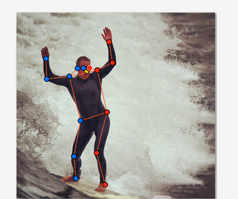
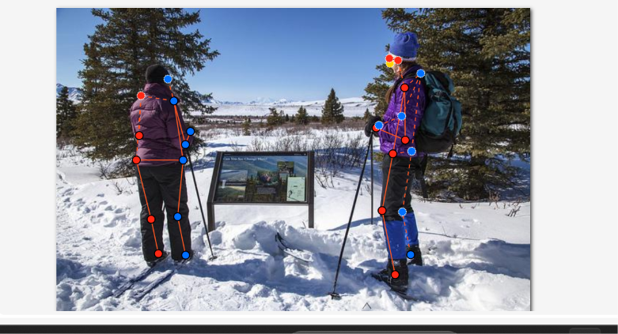
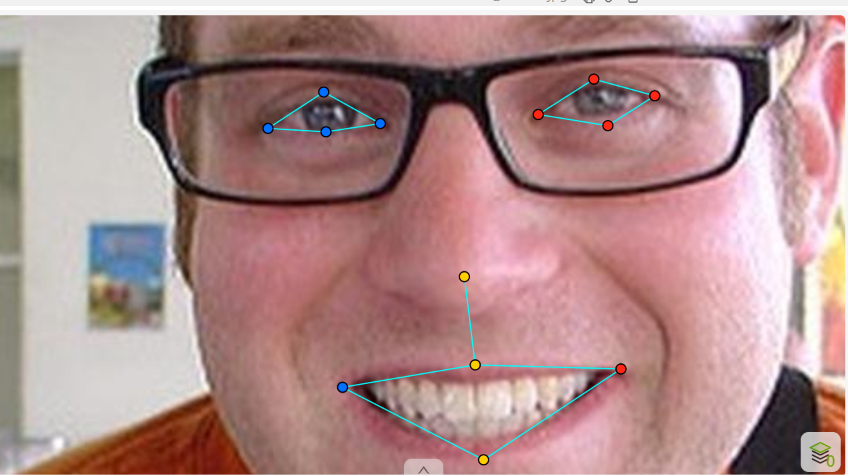
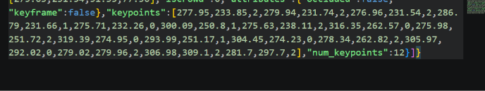

# Báo cáo cá nhân — KIEUQUANGTRUONG

> **Bản nháp theo dữ liệu hiện có.** Hai file task đã được kiểm tra tự động, nhưng hiện chưa đạt để nộp. Các mục ghi `[bổ sung]` cần được xác nhận từ người làm; không suy đoán các thông tin này.

Dữ liệu: 12 ảnh người COCO và 8 ảnh khuôn mặt. MSSV, tên và danh sách ảnh được đọc từ `src/exports/assignment.json`.

## 0. Thông tin học viên

- Họ tên: KIEUQUANGTRUONG
- MSSV: 2A202603205
- Email: [bổ sung]
- Link repository: [bổ sung]
- Phiên bản CVAT (Help → About): [bổ sung]
- Máy: hệ điều hành [bổ sung] · RAM [bổ sung] GB · CVAT chế độ [đầy đủ / lite]
- Bộ ảnh (`src/exports/assignment.json`): có
- Giờ bắt đầu: [bổ sung]
- Giờ kết thúc: [bổ sung]

## 1. Kiểm tra label (CP0)

Thông tin dưới đây được xác minh từ danh mục keypoints/skeleton trong file COCO của hai task; chưa xác minh trực tiếp label constructor trên CVAT.

| Label | Kiểu | Số điểm | Tên điểm đúng schema trong file? | Đúng thứ tự schema? | Số cạnh |
|---|---|---:|---|---|---:|
| `person` | Skeleton | 17 | Có | Có | 19 |
| `face` | Skeleton | 13 | Có | Có | 13 |

- Mẫu `person` dựng theo người quay mặt về camera: [xác nhận trên CVAT]
- Cách đổi cờ `occluded` / `outside` cho một điểm trên phiên bản CVAT đã dùng: [bổ sung]

## 2. Số lượng đã gán và thời gian (CP1, CP2)

Số skeleton dưới đây được đếm trong hai file task hiện có. Đây là số đối tượng đã xuất, không phải số người thấp hơn 60 px hoặc số người bị bỏ qua.

| Nhóm ảnh | Số ảnh | Số skeleton đã xuất | Số người dưới 60 px không gán | Số poster / gương / màn hình bỏ qua | Thời gian (phút) |
|---|---:|---:|---:|---:|---:|
| `easy` | 5 | 5 | [bổ sung] | [bổ sung] | [bổ sung] |
| `occluded` | 3 | 5 | [bổ sung] | [bổ sung] | [bổ sung] |
| `back` | 2 | 3 | [bổ sung] | [bổ sung] | [bổ sung] |
| `small` | 1 | 4 | [bổ sung] | [bổ sung] | [bổ sung] |
| `crowd` | 1 | 3 | [bổ sung] | [bổ sung] | [bổ sung] |
| `faces` | 8 | 7 | — | — | [bổ sung] |

- Số ảnh người hoàn thành ở mốc phút 105: [bổ sung] / 10
- Thời gian thực tế (phút): CP1 [bổ sung] · CP2 [bổ sung] · CP3 [bổ sung]
- Ảnh tốn thời gian nhất và lý do: [bổ sung]

## 3. Bảng ca khó (CP1, CP2)

Các dòng đầu là những điểm cần kiểm tra/sửa theo kết quả tự kiểm; không phải ghi nhận rằng lỗi đã được sửa.

| Ảnh | Người / mặt | Điểm | Cờ hiện tại | Phân vân / vấn đề | Hướng xử lý |
|---|---|---|---:|---|---|
| `000000179201.jpg` | người #1 | `left_elbow` | 2 | Tọa độ xuất `648, 321` nằm ngoài ảnh | Kiểm tra trên CVAT; nếu khớp ngoài ảnh, đặt `outside` |
| `000000189365.jpg` | người #1 | `right_hip` | 1 | Tọa độ xuất `-13, 373` nằm ngoài ảnh | Kiểm tra trên CVAT; nếu khớp ngoài ảnh, đặt `outside` |
| `000000572411.jpg` | người #1 và #3 | — | — | Độ cao skeleton lần lượt 31 px và 21 px; script cảnh báo ngưỡng dưới 60 px | Kiểm tra kích thước người và quyết định giữ/bỏ theo guideline |
| `face_146049.jpg` | mặt | toàn bộ skeleton | — | Chưa có skeleton `face` trong file xuất | Gán một skeleton mặt nếu ảnh thuộc task cần làm |
| [bổ sung] | | | | | |

## 4. Bảng tự review (CP3)

**Chưa có ghi chép tự review trong các file được cung cấp.** Cần tự kiểm tra 5 ảnh người (ít nhất 2 ảnh `back` hoặc `crowd`) và 3 ảnh mặt trên CVAT, rồi điền bảng. Không đánh dấu “đã sửa” cho đến khi sửa và lưu trên CVAT.

| Ảnh | Người / mặt | Điểm | Mã lỗi | Ghi chú | Đã sửa? |
|---|---|---|---|---|---|
| [bổ sung] | | | | | |
| [bổ sung] | | | | | |
| [bổ sung] | | | | | |
| [bổ sung] | | | | | |
| [bổ sung] | | | | | |
| [bổ sung] | | | | | |
| [bổ sung] | | | | | |
| [bổ sung] | | | | | |

Tổng hợp số lỗi theo mã sau khi review:

| `lr_swap` | `vis_flag` | `position` | `missing` | `extra` | `ok` |
|---:|---:|---:|---:|---:|---:|
| [bổ sung] | [bổ sung] | [bổ sung] | [bổ sung] | [bổ sung] | [bổ sung] |

Điểm phân vân giữa `v = 1` và `v = 0`, ghi cả lựa chọn và lý do: [bổ sung]

## 5. Kiểm file xuất và kết quả tự kiểm (CP4)

Hai file đang có là file export gốc của job 10 và job 11. Kiểm tra cho thấy annotation có đúng độ dài mảng (51 số cho người, 39 số cho mặt). Tuy nhiên, hiện chưa có đủ hai file với tên chuẩn trong `src/exports/` để nộp.

| File đã kiểm | Người / mặt kiểm | Số phần tử `keypoints` | Kết quả kiểm cờ và số điểm |
|---|---|---:|---|
| `job_10_annotations_2026_11_12_12_10_51_coco keypoints 1.0.zip` | 20 skeleton người trong 12 ảnh | 51 mỗi annotation | Có 2 điểm `v > 0` nằm ngoài ảnh; cần sửa trên CVAT |
| `job_11_annotations_2026_11_12_12_12_20_coco keypoints 1.0.zip` | 7 skeleton mặt trong 8 ảnh | 39 mỗi annotation | Một ảnh chưa có skeleton; cần bổ sung |

- CVAT xuất `occluded` thành `v = 1`; `outside` thành `v = 0`.
- Ghi chú của script: các điểm `v = 0` trong file hiện vẫn mang tọa độ cũ.
- Hai job đã chuyển sang `completed` trên CVAT: [cần kiểm tra trực tiếp trên CVAT]
- `src/exports/KIEUQUANGTRUONG_persons.zip` hiện có 12 ảnh nhưng **0 annotation**; cần xuất lại từ task sau khi sửa. Chưa thấy `src/exports/KIEUQUANGTRUONG_faces.zip`.

Kết quả `python src/check_submission.py --persons "job_10_annotations_2026_11_12_12_10_51_coco keypoints 1.0.zip" --faces "job_11_annotations_2026_11_12_12_12_20_coco keypoints 1.0.zip"`:

```text
- File person: job_10_annotations_2026_11_12_12_10_51_coco keypoints 1.0.zip
  Số ảnh: 12 · số skeleton `person`: 20 · mỗi annotation 51 số
  Skeleton theo ảnh: 000000027565=1, 000000043500=2, 000000103970=1, 000000179201=2, 000000189365=1, 000000194027=1, 000000205650=1, 000000294379=1, 000000381889=3, 000000391222=1, 000000516902=2, 000000572411=4
  Cờ v: v=2 241 (71%) · v=1 39 (11%) · v=0 60 (18%)
  num_keypoints trung bình: 14.0
- File face: job_11_annotations_2026_11_12_12_12_20_coco keypoints 1.0.zip
  Số ảnh: 8 · số skeleton `face`: 7 · mỗi annotation 39 số
  Skeleton theo ảnh: face_146049=0, face_178208=1, face_232598=1, face_356144=1, face_362568=1, face_425647=1, face_483667=1, face_53580=1
  Cờ v: v=2 89 (98%) · v=1 2 (2%) · v=0 0 (0%)
  num_keypoints trung bình: 13.0
- Ghi chú: 60 điểm v = 0 vẫn mang tọa độ cũ (CVAT 2.x xuất như vậy; chuẩn COCO ghi 0, 0). Không phải lỗi: điểm v = 0 bị bỏ qua khi huấn luyện và khi chấm.
- Số [LỖI]: 2 · số [CẢNH BÁO]: 3
Kết quả: CHƯA ĐẠT (2 lỗi). Sửa trên CVAT rồi xuất lại.
```

## 6. Ảnh chụp màn hình

Chưa có ảnh chụp trong `report/individual/images/` ngoài file giữ thư mục `.gitkeep`. Bổ sung đủ 4 ảnh sau khi hoàn tất/sửa task:

1. Label `person` trong label constructor:

   

2. Một người quay lưng đã gán, thấy cờ đã đặt:

   

3. Khuôn mặt đã gán 13 điểm, phóng to vùng mắt:

   

4. Một đoạn JSON export của một người:

   

Nguồn ảnh: COCO val2017 / Wikimedia Commons.

## 7. Tự đánh giá

1. Lỗi mắc nhiều nhất hôm nay và cách tránh ở dự án thật: [bổ sung]
2. Một quy tắc đề xuất thêm vào guideline, kèm ví dụ nếu có: [bổ sung]
3. Một lỗi đã sửa và ảnh hưởng của nó tới mô hình (heatmap, loss hoặc lật ảnh): [bổ sung]

## 8. Khó khăn và lỗi kỹ thuật

Các vấn đề đang được script tự kiểm phát hiện: 2 điểm người nằm ngoài biên ảnh nhưng có `v > 0`; 2 skeleton trong ảnh `000000572411.jpg` có độ cao dưới 60 px; thiếu skeleton mặt trong `face_146049.jpg`. Cần kiểm tra và xử lý trên CVAT, xuất lại, rồi chạy kiểm tra lần cuối. Khó khăn/lỗi kỹ thuật khác: [bổ sung]

## Bonus (nếu làm)

Chưa có bằng chứng/file export bonus trong dữ liệu hiện có. Nếu không làm, ghi “Không thực hiện”.

## 9. Tài liệu tham khảo và công cụ AI đã dùng

- Tài liệu lab: `docs/GUIDELINE.md`, `docs/COCO_KEYPOINTS.md`, `docs/CVAT_CHEATSHEET.md`.
- Công cụ kiểm tra: `src/check_submission.py`.
- Công cụ AI đã dùng: [bổ sung hoặc ghi “Không sử dụng”].
